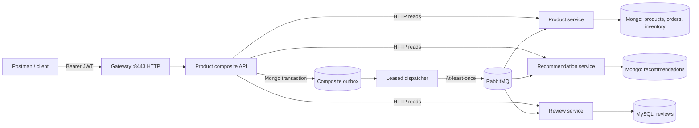

# Amazon Clone Backend

**Java 17 · Spring Boot 3.1 · Spring Cloud · MongoDB · MySQL · RabbitMQ · OAuth2 · Docker Compose**

A distributed commerce **portfolio prototype** with product discovery, carts, multi-item order reservations, mock payments and fulfillment, review workflows, and deliberately tested messaging failure paths. It is **not a production e-commerce platform**: payments, shipping, and refunds are simulated.

## Start here

| Resource | Purpose |
| --- | --- |
| [Architecture](docs/ARCHITECTURE.md) | Service boundaries, data stores, consistency and failure semantics |
| [Aggregate reconciliation](docs/RECONCILIATION.md) | Read-only operator snapshot checks, statuses and recovery gaps |
| [Durable operation tracking](docs/OPERATIONS.md) | Atomic outbox-operation journal, publisher progress and saga boundaries |
| [Consumer receipt evidence](docs/RECEIPTS.md) | Authenticated read-only consumer transaction verification |
| [Fenced saga supervision](docs/SAGA_SUPERVISION.md) | Opt-in bounded recovery status monitor; no compensation |
| [Operator triage](docs/SAGA_TRIAGE.md) | Review queue and idempotent investigation notes without replay |
| [Recovery operator controls](docs/RECOVERY_CONTROLS.md) | Safe manual evidence rechecks, retry budget and queue-head diagnostics |
| [Auth signing key hardening](docs/AUTH_HARDENING.md) | Opt-in persistent RSA JWT keys, credential checks and rotation limitations |
| [Recovery observability](docs/RECOVERY_OBSERVABILITY.md) | Outbox/saga metrics, alerts, dashboard, failure modes |
| [Live demo walkthrough](docs/DEMO.md) | Reproducible local demo and broker-recovery recording plan |
| [Postman collection](postman/Amazon-Clone-Backend.postman_collection.json) | Authenticated request flow and assertions |
| [Sample product](samples/product-demo.json) | Non-sensitive product/review/recommendation test data |
| [Full engineering notes](docs/REFERENCE.md) | Preserved detailed development notes, including historical draft caveats |
| [CI workflow](.github/workflows/gradle-ci.yml) | Java 17 / Gradle 8.6 tests and portfolio asset checks |

## What is implemented

- **API boundary:** Spring Cloud Gateway routes authenticated HTTP calls to the composite API; OAuth2/JWT scopes protect customer and operator operations.
- **Catalog and commerce:** product listing, recommendations, reviews, carts, wishlists, multi-line checkout, expiring reservations, mock payment state transitions, simulated shipping/returns, and order history.
- **Inventory consistency:** the product service uses MongoDB multi-document transactions for multi-line stock reservation and terminal order transitions; there is a **read-only**, bounded inventory audit. This is not a full, globally fenced inventory ledger.
- **Asynchronous reliability:** composite **transactional outbox** (PR #20), retryable leased dispatcher and consumer-side processed-event inboxes (PR #19), plus a [read-only aggregate reconciliation audit](docs/RECONCILIATION.md) and [durable operation journal](docs/OPERATIONS.md) and [signed consumer inbox evidence](docs/RECEIPTS.md) for verifying tracked consumer commits. An [opt-in fenced supervisor](docs/SAGA_SUPERVISION.md) records bounded diagnostic outcomes, not business compensation. Delivery is **at least once**; this audit is **not** a complete saga or convergence guarantee.
- **Operations:** Docker Compose, Testcontainers-backed Java CI, Prometheus/Grafana and Zipkin, plus [bounded read-only outbox/saga telemetry](docs/RECOVERY_OBSERVABILITY.md) and a local smoke test.

## Run locally

Prerequisites: **Java 17**, trusted **Gradle 8.6** installation, **Docker Engine + Compose v2**, Bash and curl. The old Gradle wrapper was removed after an integrity issue; do not restore its unverified binary.

1. Copy `.env.example` to `.env`; replace all example secrets with fresh local values.
2. Check configuration in the separate [config-repo](https://github.com/kakarot987/config-repo) and align its credentials/URLs with `.env`. Rotate any credentials previously exposed in Git history.
3. Run:

```bash
cp .env.example .env
# Edit .env, then:
gradle clean build
docker compose config
docker compose up --build -d
docker compose ps
./scripts/smoke-test.sh
```

The gateway is **HTTP** at `http://localhost:8443` (the port number does **not** imply TLS). Host-facing management ports are bound to localhost in the default Compose file. MongoDB is a **single-node rs0 replica set for development**; do not delete or reinitialize an existing data volume without a backup/migration plan.

The smoke test checks gateway health and rejects an unauthenticated catalog request. For a real product flow, obtain a **signed-in demo-user access token** with `product:read` and `product:write` scopes from your configured OAuth2 authorization-code flow, then run:

```bash
ACCESS_TOKEN="your-local-demo-token" bash scripts/demo-catalog.sh
```

The auth server also has an [opt-in persistent signing key setup](docs/AUTH_HARDENING.md) with strict local credentials; its identity/client store remains in memory. The authorization server is not published on a host port in default Compose; token acquisition needs an explicitly configured **localhost-only** development access path. Do not paste tokens into Git or commit Postman environments. The demo script creates a unique sample product, expects `202 Accepted` for persisted outgoing intent, and polls the eventually consistent read endpoint. The [walkthrough](docs/DEMO.md) covers the Postman cart/checkout flow, optional operator audit, and manual RabbitMQ outage/recovery exercise.

## Architecture at a glance



See [architecture details](docs/ARCHITECTURE.md) for the OAuth2 server, discovery/config, monitoring, transaction boundaries, and event replay limitations.

## Honesty about boundaries

This is a **demonstrable distributed-systems project**, not a real-money application. The auth server uses in-memory demo users/clients and regenerates signing keys; the default Compose setup is not production TLS, high availability, or hardened secret management. Publisher acceptance is **not** a durable broker confirmation. Poison events may block the outbox queue; consumer retry/inbox behavior does not replace distributed reconciliation or saga compensation. The bounded inventory audit detects discrepancies but does not repair them. Alternative Compose variants require configuration review before use with transaction-requiring services.

For production adoption: persistent identity/signing keys, credential rotation, broker confirms/operational DLQ controls, bounded replay/reconciliation, proper data migrations, durable inventory movement audit, load/fault testing and hardened deployment would be required.

**Portfolio demo status:** source-controlled assets are provided; a successful local Docker run and an actual screen recording must be performed separately. The full [engineering notes](docs/REFERENCE.md) are retained for design tradeoffs, but may contain historical phase-level statements superseded by later work.
