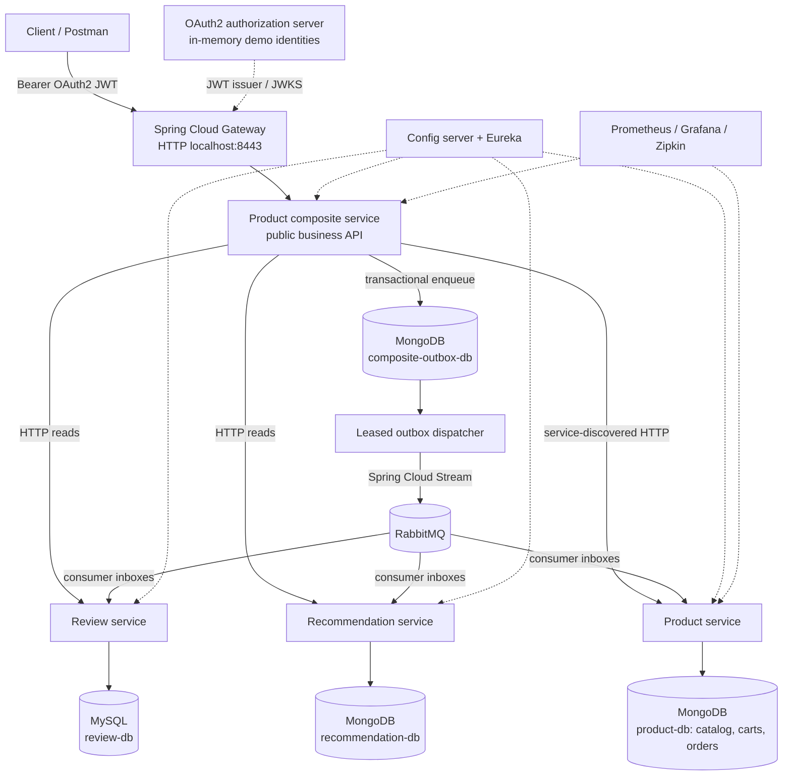
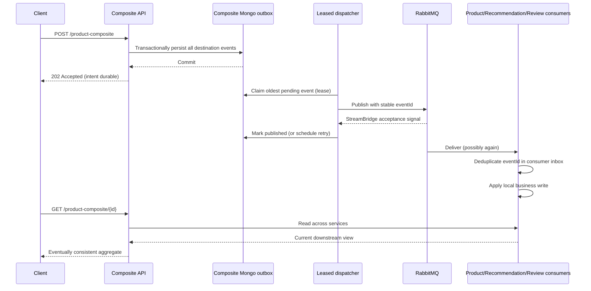

# Architecture and consistency model

This document describes the current **default RabbitMQ Docker Compose** topology, not a production deployment or the alternate Kafka/partitioned Compose configurations.

## Service topology

All databases and brokers are on the internal Compose network. The gateway and some development observability endpoints bind to `127.0.0.1`, not the public internet. Services need a matching [external config-repo](https://github.com/kakarot987/config-repo). Replica-set transactions require `rs0` in the default MongoDB setup.

## Aggregate write sequence

**Commit boundaries:** The composite outbox transaction atomically stores **outgoing event intent**, not downstream product/review/recommendation changes. The dispatcher retries rejected sends and expired leases; its `StreamBridge.send` return is **not** a broker publisher confirm. Replay is possible. Consumer inboxes stop duplicate application of the same event ID, but cannot guarantee that every downstream service eventually succeeds. One failing queue head can block subsequent outgoing events. A distributed saga with explicit acknowledgement/reconciliation and controlled replay is still future work.

## Inventory and checkout

The **product service** owns products, carts, orders and inventory. Checkout snapshots the cart, creates an order intent and reserves up to 20 distinct products. The reservation of all line-item stock plus the order's final `RESERVED` transition uses a **reactive MongoDB multi-document transaction** with majority writes. Cancellation, expiry, mock decline and mock payment completion similarly transition product holds/order state transactionally. An order idempotency key and per-product hold token protect retries; lease-based recovery exists for interrupted processing.

The guarantee is **local transactional inventory consistency within the product MongoDB database**, not a distributed transaction across databases, real payment authorization, or a globally fenced reservation ledger. Transaction conflicts can fail a request; clients should retry with the **same** idempotency key. `GET /product-composite/fulfillment/inventory/reconciliation` is a read-only bounded operator audit (up to 100 products / 100 active orders); it may report `truncated` and **does not repair inventory**.

## Security and simulated business operations

JWT scope checks protect catalog, carts, orders and operator endpoints. Personal cart/checkout ownership is derived from verified JWT issuer and subject; client-credentials tokens are not customer identities. The demo authorization server stores users and clients **in memory** and generates a signing key at startup; its default Compose endpoint is internal. Real persistent customer accounts and stable production keys remain future work.

Payment intents, signed **mock** webhooks, shipment state changes and refunds are **simulations**, not integrations with real financial or carrier systems. Run the demo on disposable local data.

## Operational caveats

- Default Compose: MongoDB single-member replica set (development only), MySQL, RabbitMQ, Config Server, Eureka, auth server, gateway, product/composite/recommendation/review services, Prometheus, Grafana and Zipkin.
- Java 17 + Gradle 8.6 GitHub Actions exercises build/tests (including Testcontainers). A passing test run is not proof of end-to-end Docker runtime or production suitability.
- Outbox and inbox records retain history; capacity, retention, secrets, high-availability, alerting and operator replay controls need further design.
- See [demo](DEMO.md) for a reproducible broker-outage scenario and [full engineering notes](REFERENCE.md) for earlier milestones and test details.

## Bounded distributed reconciliation audit

An operator with `fulfillment:read` can query `GET /product-composite/fulfillment/aggregates/{productId}/reconciliation`. The endpoint compares a bounded history of outgoing event intent to independently fetched downstream product/recommendation/review identity sets. It distinguishes pending publication, unavailable consumers, recent convergence windows and possible drift. It **does not** retry, repair, compensate or prove global consistency. See [operator reconciliation runbook](RECONCILIATION.md).
