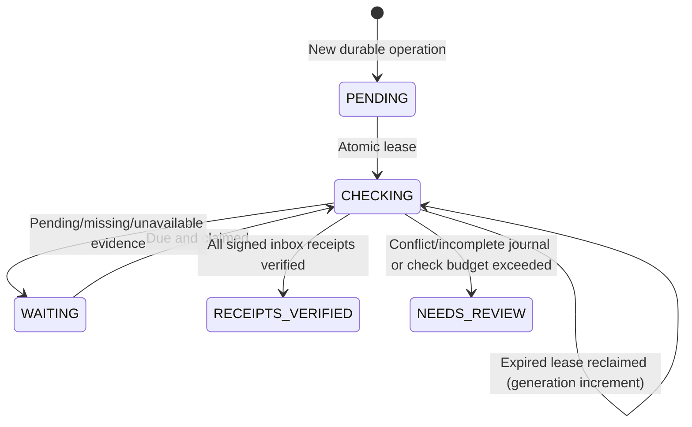

# Durable fenced saga supervision — read-only coordinator

This phase adds **operator-visible supervision**, not business-action recovery. Every **new** composite outbox batch now atomically persists three things in the same replica-set transaction: the aggregate operation intent, its outgoing event records and a `PENDING` supervision document keyed by the operation UUID.

The supervisor is disabled by default. To opt in, set `APP_SAGA_ENABLED=true` in your local uncommitted `.env` file and restart the composite service. A matching 32+ byte `APP_RECEIPT_PROBE_SECRET` must be configured on the composite, product, recommendation and review services. Do not enable the worker in production without validating index creation, network isolation, clocks, CI and failure tests.

## Operator endpoint

```http
GET /product-composite/fulfillment/operations/{operationId}/supervision
Authorization: Bearer <fulfillment:read operator JWT>
```

This is always **read-only**, even when the worker is disabled. It returns 404 for unknown operation supervision records (including operations created before the migration), 400 for invalid operation IDs. The endpoint does **not** trigger a retry, replay or compensation.

## State transitions



- `PENDING`: newly persisted intent; no inspection yet. The worker only runs when enabled.
- `CHECKING`: one worker has an atomic 90-second lease, a random lease token and a monotonically incrementing generation.
- `WAITING`: inconclusive, pending or missing receipts; next check has exponential backoff, capped at 300 seconds.
- `RECEIPTS_VERIFIED`: all tracked events had valid, matching, transactionally committed inbox receipts. **Not** proof of current aggregate convergence, billing, fulfillment or a completed business saga.
- `NEEDS_REVIEW`: detected conflict/incomplete journal or exhausted the **12-check** budget; no further automatic probing. No data repair is attempted.

The coordinator scans at most 10 due records per pass. Signed consumer receipt checks are bounded by 20 seconds per operation. Lease settlement is a MongoDB conditional update requiring the exact lease ID, generation and unexpired lease; an expired/stale worker cannot overwrite a newer claim. A failure or timeout is recorded as inconclusive and retried within the check budget, never interpreted as missing stock or successful compensation.

## Caveats and operations

- This supervisor changes only its own metadata. It **never** sends a new business event, edits the product/review/recommendation database, refunds money or rolls back inventory.
- An operation's event IDs remain immutable. Repeat HTTP writes still lack request-level idempotency; this feature does not solve duplicate user requests.
- A broker sender marking an event `PUBLISHED` is not a durable broker confirmation. Signed inbox receipts are historical per-service commits, not a global snapshot.
- The supervisor is opt-in to avoid unexpected load, extra internal API traffic or automatic state changes after merge.
- Physical indexes must exist for efficient due-item scans: verify the `aggregate_supervisions` collection's `saga_supervision_due_idx` in the composite Mongo database. Mapping annotations do not guarantee deployed indexes were created.
- If an operator sees `NEEDS_REVIEW`, investigate original outbox event ID, consumer receipts, snapshot drift, broker/DLQ logs and worker lease history. No force-complete or repair endpoint is provided.
- A future phase may introduce **explicitly approved** quarantined replay and compensation, but requires target-service acknowledgements, versioned policies, conditional fences, deterministic idempotency and forced-crash tests. Do not infer permission to compensate from a missing receipt.

## Demonstration

Use the default [Postman collection](../postman/Amazon-Clone-Backend.postman_collection.json): create a disposable aggregate; use operator-scoped requests to list operation IDs and check original receipts, then view the supervision record. In a safe local broker-outage exercise, it may show `WAITING` before `RECEIPTS_VERIFIED` after recovery. Results depend on actual runtime conditions. Document and show CI separately rather than promising a specific outcome.

## Operator incident triage

A separate [operator triage workflow](SAGA_TRIAGE.md) now lists `NEEDS_REVIEW` supervision records and accepts append-only, idempotent investigation notes on those cases only. Adding a note **does not** resolve/quarantine further, modify the supervision state, resend an event, compensate a saga or change any business data. Read requires `fulfillment:read`; writing a note requires `fulfillment:write` and a verified operator JWT. This remains a human investigation aid, not a recovery execution workflow.

## Manual, audited evidence recheck requests

A separate [recovery controls runbook](RECOVERY_CONTROLS.md) describes the operator-only manual recheck of a `NEEDS_REVIEW` record. A request is **not** an event replay: it atomically creates an immutable intent record and resets only the local supervision metadata to `PENDING` (including a new generation), so the opt-in worker may re-evaluate signed consumer receipts. This remains disabled if `APP_SAGA_ENABLED=false`; manual requests do not force the worker to run. Operators may issue at most three rechecks per operation.
